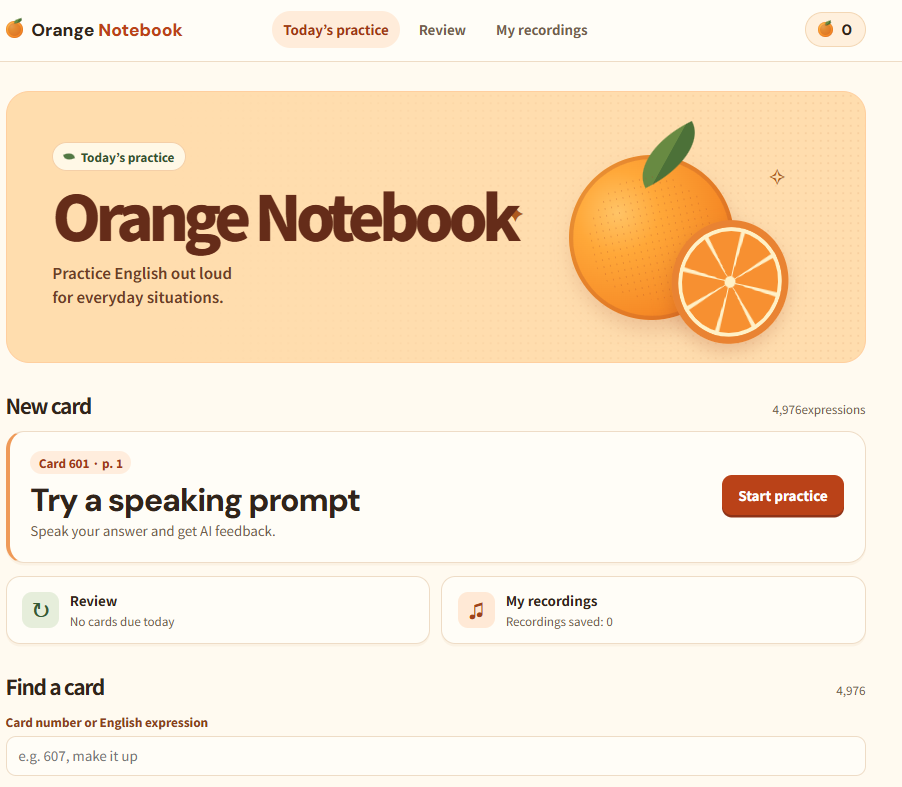

# Orange Notebook 🍊

I used to save English phrases I liked in a notebook. My list kept growing, but I barely practiced saying them out loud. Then, when I wanted to use one in a real conversation, it wouldn’t come to mind. So I made a little site to practice. 🌱

🎙️ I pick a card, read the situation in Korean, and answer out loud in English. If I get stuck, I flip the card for an example. The next day, I can try the same phrase in a new situation and earn an orange. 🍊

✨ I built it with React and TypeScript and connected two APIs. OpenAI turns my recording into text, and Gemini gives me feedback after I’ve checked the transcript. Both API keys stay on the server.

### Try it locally 🌿

With Node.js 24, run `npm ci` and `npm run dev`. For transcription and feedback, copy `.env.example` to `.env.local` and add your `OPENAI_API_KEY` and `GEMINI_API_KEY`. On Vercel, add those same keys in the project’s environment settings.